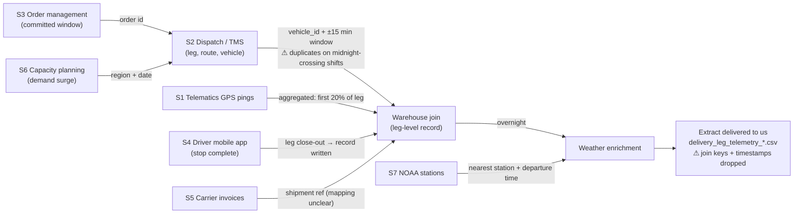

# Data Source Inventory & Relationship Map

**Author:** Junyue Li
**Project:** junyueli-ds-project
**Stage:** Week 1 · Domain Onboarding & Data Source Mapping
**Inputs reviewed:** `README.md`, `DATA_DICTIONARY.md`, `notes/from_the_ml_engineer.md`, `data/delivery_leg_telemetry_train.csv`
**Not opened:** `data/delivery_leg_telemetry_holdout.csv`, which is sealed until week 4. All figures below come from the **training file only** (2,400 rows) and can be reproduced with `scripts/profile_train.py`.

---

## 1. Summary

The modelling table is **not a raw source**. It is a single, pre-joined extract that the warehouse builds from at least six upstream systems. Its main limitation is that **the keys used to build it were dropped**: there is no vehicle ID, driver/route ID, order ID or timestamp in the extract. As a result:

- the duplicate/mismatch problem described in the README **cannot be detected from the extract alone**;
- a **time-based train/validation split is impossible** without going back to the warehouse;
- several features are **derived summaries** (e.g. `avg_speed_kmh`), and their raw inputs (GPS pings) are not available.

Within the extract, every feature column has **6.5–7.8% missing values** (half of all rows have at least one gap). Several columns pile up at a **hard maximum**, which suggests values were clipped. One observation also **contradicts the ML engineer's note**: departure hours do not appear shifted for the West Coast.

## 2. Data Source Inventory

| # | Source system | What it records | Fields it contributes to the extract | Grain | Written / refreshed | Join key(s) | Date range |
|---|---|---|---|---|---|---|---|
| S1 | **Telematics units (GPS pings)** | Raw position/speed pings from the onboard unit | `avg_speed_kmh` (derived: mean speed over the first 20% of leg distance) | Ping (sub-minute) → aggregated to leg | Streamed; aggregated at leg close-out | `vehicle_id` + timestamp (±15-min window to dispatch) | **Unknown.** No timestamp in the extract. |
| S2 | **Dispatch records / TMS** | Leg assignment, route plan, vehicle allocation, close-out | `leg_id`, `region`, `departure_hour`, `vehicle_class`, `stop_sequence_position`, `leg_distance_km`¹, `carrier_close_code` | Leg | At dispatch; `carrier_close_code` at formal close-out | `leg_id`; `vehicle_id` to telematics | Unknown |
| S3 | **Order management (customer commitment)** | Customer-committed delivery window set at order creation | `scheduled_window_minutes` (width only) | Order → leg | At order creation | Order ID → leg (not in extract) | Unknown |
| S4 | **Driver mobile app** | Driver marks the stop complete | Triggers record creation; most likely the source of the actual arrival time behind `on_time_delivery` | Stop / leg | At leg close-out | `leg_id` / stop ID | Unknown |
| S5 | **Carrier invoices** | Billing and final disposition from the carrier | Not clearly mapped to any column. Possibly confirms `carrier_close_code` / delivered status. | Shipment / invoice | Post-delivery, billing cycle | Shipment / leg reference (not in extract) | Unknown |
| S6 | **Capacity planning system** | Demand-surge flags per region and day | `demand_spike_flag` | Region × day | Daily / intraday (unclear) | `region` + date (date not in extract) | Unknown |
| S7 | **NOAA weather stations** | Observed weather category at the nearest station | `weather_condition` (at departure time) | Station × time | **Overnight batch enrichment** | Nearest station to depot + departure timestamp | Unknown |
| — | **Derived target** | Arrival vs. committed window | `on_time_delivery` | Leg | After the outcome | — | — |

¹ `leg_distance_km` is the straight-line distance from depot to address. It is most likely computed from the dispatch plan (depot and address geocodes) rather than from GPS.

## 3. Relationship Map



**Timing of availability, which matters for leakage:**

| When | Fields that exist |
|---|---|
| Order creation | `scheduled_window_minutes` |
| Dispatch | `region`, `vehicle_class`, `stop_sequence_position`, `leg_distance_km`, `demand_spike_flag` |
| Departure | `departure_hour`, `weather_condition` (observed, but only **joined overnight**) |
| 20% of the leg completed (**prediction point**) | `avg_speed_kmh` |
| Leg close-out / after outcome | `carrier_close_code`, `on_time_delivery`. **Never usable as model input.** |

## 4. Schema Summary of the Extract (training file)

| Column | Type | Missing | Observed range / levels | Notes |
|---|---|---|---|---|
| `leg_id` | id | 0% | `TR-00001` … `TR-02400`, no duplicates | Sequential. The order may or may not reflect time; this needs confirming. |
| `region` | categorical | 0% | West Coast 475, Midwest 458, Southwest 456, Southeast 442, Northeast 435, **Mountain 134** | Mountain is a thin segment at 5.6% of rows. |
| `scheduled_window_minutes` | numeric | 7.3% | 31 – 480 (median 282) | **137 rows exactly at 480** |
| `leg_distance_km` | numeric | 7.0% | 1.51 – 420 (median 238) | **129 rows exactly at 420**; 43 legs < 10 km |
| `departure_hour` | numeric | 6.7% | 0 – 23 | **Hour 23 has 180 rows, about twice any other hour (≈80–110)** |
| `weather_condition` | categorical | 6.8% | Clear 1,546; Snow 152; Light Rain 143; Fog 140; Severe Storm 133; Heavy Rain 123 | |
| `avg_speed_kmh` | numeric | 6.5% | 8 – 105 (median 62) | **164 rows exactly at 105** |
| `vehicle_class` | categorical | 7.8% | Light Van 1,574; Heavy Rigid 181; Refrigerated 169; Medium Rigid 151; Articulated 139 | |
| `stop_sequence_position` | numeric | 7.0% | 1 – 22 | **191 rows exactly at 22** |
| `demand_spike_flag` | boolean | 6.5% | True 1,119 / False 1,125 | Balanced, so about half of all legs are "surge". That's an unusually high share for a "spike". |
| `carrier_close_code` | categorical (0/1) | 11.7% | 1 → 1,773; 0 → 346 | **Post-outcome.** Excluded from features. |
| `on_time_delivery` | target | 0% | 1 → 1,985 (82.7%); 0 → 415 (17.3%) | Imbalanced. Investigated in week 2. |

## 5. Coverage Gaps

| # | Gap | Impact | Severity |
|---|---|---|---|
| G1 | **No date or timestamp column.** | No temporal split (weeks 4–5), no seasonality and no lag features, and the date range of the data is unknown. | **High** |
| G2 | **No `vehicle_id`, driver ID, route ID or order ID.** | The midnight duplicate problem can't be found, legs can't be grouped into routes (to check for cascading delays), and nothing can be re-joined to sources. | **High** |
| G3 | **Only the window *width* is given, not its start and end.** | The time remaining in the window at the prediction point cannot be computed, and that is likely the strongest real-time feature. | **High** |
| G4 | **No raw GPS pings**, only the 20%-of-leg speed summary. | No way to recompute speed over a minimum distance (the fix the ML engineer recommends) and no progress-based features. | Medium |
| G5 | **No actual arrival time / minutes late.** | Only a binary label. Severity of lateness and near-misses can't be distinguished. | Medium |
| G6 | **Carrier invoice fields are not identifiable** in the extract. | It's unclear what S5 contributes, and whether any column comes from post-delivery billing (a leakage risk). | Medium |
| G7 | **No road or route distance** (only straight-line). | Under-estimates travel effort in dense urban areas and difficult terrain (e.g. Mountain). | Low–Medium |
| G8 | **No traffic data.** | `avg_speed_kmh` is the only congestion proxy. Week 6 plans to add this externally. | Low (for now) |

## 6. Quality Concerns Found in the Training File

Listed by priority. Each concern can be traced to a check in `scripts/profile_train.py`.

| # | Concern | Evidence | Likely cause / hypothesis | Next step |
|---|---|---|---|---|
| Q1 | **Leaking column** | The data dictionary marks `carrier_close_code` as "after the outcome is known". It is entered at formal close-out and confirms final disposition. | Post-outcome field populated downstream | Exclude from all features; quantify its agreement with the target in the week 3 leakage audit |
| Q2 | **Possible join duplicates on midnight-crossing shifts** | README: the join on vehicle ID + 15-min window "occasionally produces duplicate or mismatched rows". There are **0 duplicate `leg_id`s and 0 exact duplicate rows** in the extract, so duplicates can't be seen here. **Hour 23 is about 2× overrepresented** (180 vs ≈80–110). | Duplicated or mis-assigned late-shift records may sit at hour 23 with new `leg_id`s; alternatively, hours past midnight may be clipped to 23 | Ask for `vehicle_id` + timestamps (G2); in week 2, compare the label rate and feature profile of hour-23 legs with other hours |
| Q3 | **Values piled at a hard maximum** | `leg_distance_km` = 420 (129 rows), `avg_speed_kmh` = 105 (164), `scheduled_window_minutes` = 480 (137), `stop_sequence_position` = 22 (191), `departure_hour` = 23 (180). 370 rows hit at least one cap, and 47 hit both the distance and window caps together. | Capping/winsorising upstream, or a default value for out-of-range readings | Treat these as censored; add "at cap" indicator flags; ask the data owner what the caps mean |
| Q4 | **Missing values throughout** | 6.5–7.8% in every feature column, 11.7% in `carrier_close_code`; **1,194 of 2,400 rows (50%) have at least one missing value** | Partial joins, e.g. weather not matched or telematics gaps | Do not drop rows with missing values (that would lose half the data). Impute and add missing-value indicators. Week 2: check whether missing values relate to the label. |
| Q5 | **`avg_speed_kmh` is unreliable on short legs** | ML engineer note: for short urban legs the first 20% can be under 400 m. 6 legs are ≤ 2 km and 43 are < 10 km. In this file, the spread of speed is similar across distance bands (SD ≈ 26–30), so the problem is concentrated in very few rows. | Speed computed over a tiny distance window | Flag or mask speed when 20% of the leg is under a minimum distance (e.g. < 1 km); test speed only together with distance |
| Q6 | **Departure-hour/region confound not visible** | The engineer's note says the West Coast starts shifts about 3 h later. In the extract, mean `departure_hour` is **12.9 for West Coast versus 12.2–12.8 elsewhere**, with near-identical quartiles. | Hours may already be normalised (e.g. to UTC or local time), the note may describe an older pattern, or the effect may be elsewhere | **Raise with Carlos:** which time zone is `departure_hour` in? Is the 3 h shift visible elsewhere? Note what was checked and what wasn't. |
| Q7 | **Window width vs. implied travel time** | For **842 of 2,082** complete legs, distance ÷ early speed is longer than the window width, yet most of these legs are on time | The window is a *delivery-time* slot, not a travel-time budget; early speed and straight-line distance are rough proxies | Clarify window semantics (G3) before engineering "slack" features |
| Q8 | **Weather plausibility** | Snow is recorded at similar rates in Southeast (30) and Southwest (22) as in Midwest (39) and Northeast (28) | Nearest-station mapping errors, a coarse region grain, or synthetic noise | Week 2: check whether weather labels show any relationship with region/season; treat weather with caution |
| Q9 | **Thin segment** | Mountain = 134 rows (5.6%) | Small operational region | Report every metric per region, so Mountain performance doesn't vanish into the average |
| Q10 | **`demand_spike_flag` near 50/50** | True 1,119 vs False 1,125 | The flag may mark a whole surge *day* or region rather than a short spike, or the threshold may be loose | Ask the capacity planning owner what the flag definition and its time grain are |

## 7. Questions for the Team

**For Carlos Vega (ML Engineer):**
1. Can we get `vehicle_id`, a departure or close-out **timestamp** and an **order ID** for each `leg_id`? These are needed for G1, G2 and Q2.
2. Which time zone is `departure_hour` in? The West Coast +3 h shift is not visible in the extract (Q6).
3. Are the maxima at 420 km, 105 km/h, 480 min, stop 22 and hour 23 deliberate caps? What do the true values look like (Q3)?
4. At inference time, can weather be fetched live, or does it only exist after the overnight job?

**For Priya Nair (Staff Data Scientist):**
5. Can the window start/end timestamps be obtained, rather than only the width (G3)?
6. Which columns, if any, come from carrier invoices (G6)?

**For Fatima Osei (Product Manager):**
7. What does a "demand spike" mean operationally, and how often should it be on (Q10)?

## 8. Reproducibility

```bash
pip install -r requirements.txt
python scripts/profile_train.py
```

The script reads only `data/delivery_leg_telemetry_train.csv`. The `data/` folder is git-ignored, so the dataset is not in the repository.
