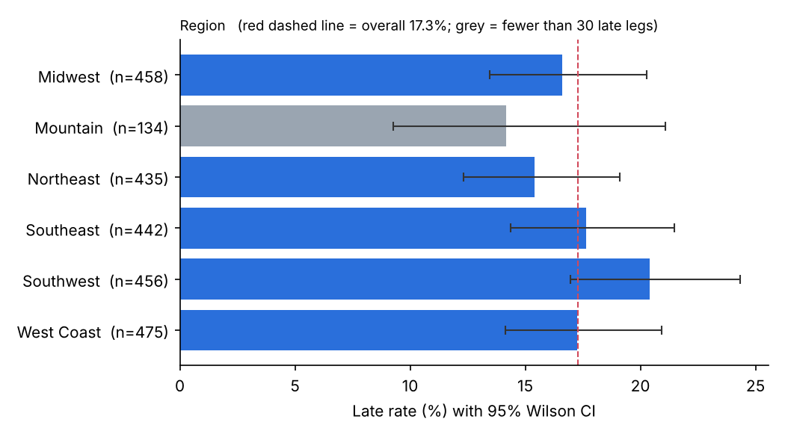
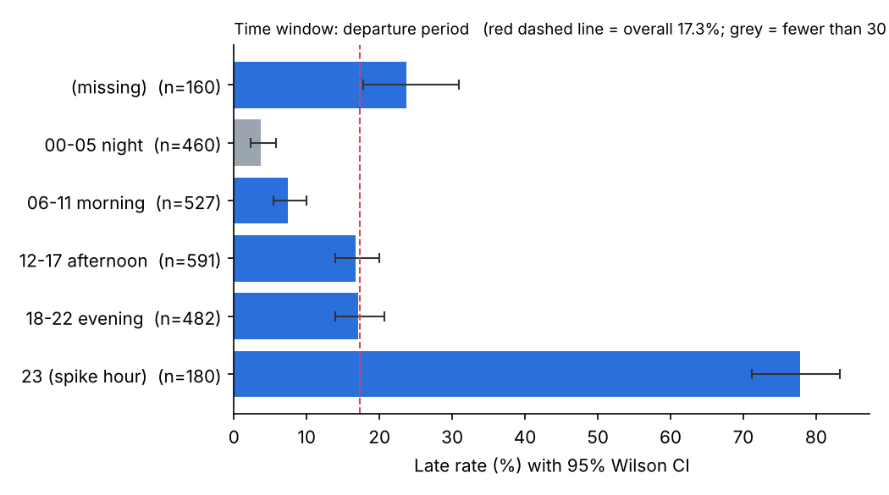
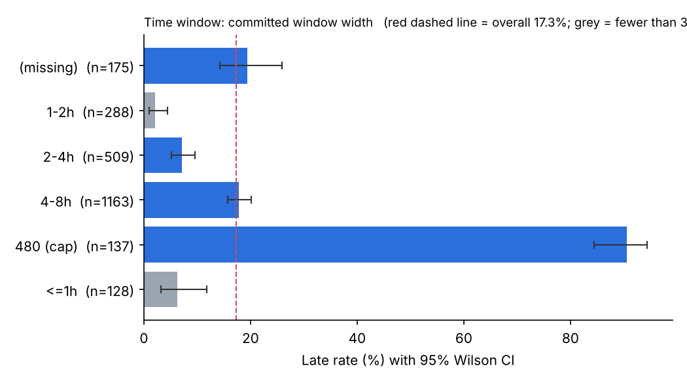
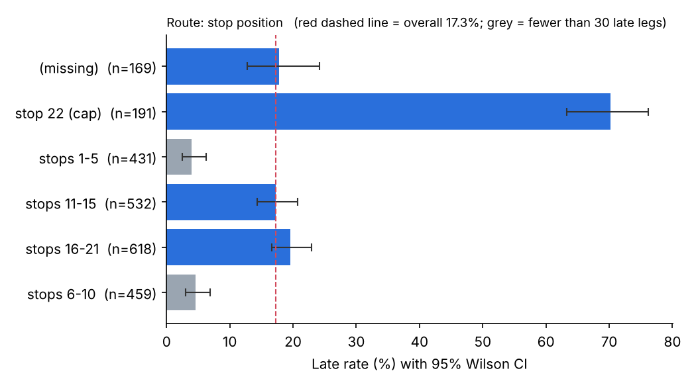
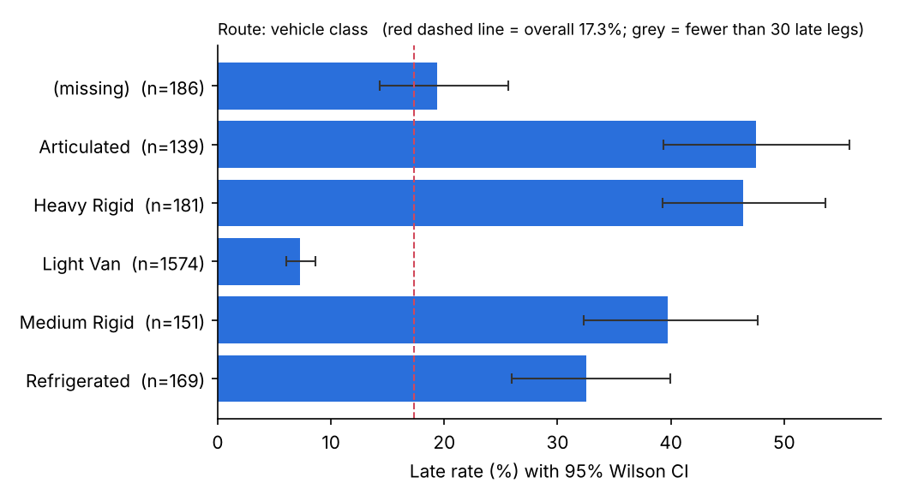

# Label Construction & Class Balance Audit

**Author:** Junyue Li
**Stage:** Week 2 · Task 1
**Reproduce:** `python scripts/build_labels.py`
**Inputs:** `data/delivery_leg_telemetry_train.csv` (2,400 rows). The holdout is still sealed.
**Outputs:** `data/processed/train_labeled.csv` (labelled dataset), `docs/week2/segment_delay_rates.csv` (full breakdown table), `docs/week2/figures/` (one chart per segment type)

---

## 1. Summary

- **Overall late rate: 17.3%** (415 of 2,400; 95% CI 15.8%–18.9%). On-time : late = **4.8 : 1**. "Always on time" scores **82.7% accuracy** while catching no late legs.
- **The imbalance is not uniform. It splits into two regimes.** **76% of all late legs** sit in a small group of 424 rows (17.7%) where at least one value is at a hard cap (420 km, 105 km/h, 480-min window, stop 22) or the departure hour is 23. That group is **74% late**. In the other 1,976 rows the late rate is only **5.1%**, an imbalance of about **19 : 1**.
- **Region barely matters** (χ² p = 0.39). Weather and vehicle class look like strong drivers overall (Clear 7% vs. bad weather 36–44%; Light Van 7% vs. trucks 33–48%), **but most of that disappears outside the extreme-value regime** (Clear 4.4% vs. bad weather 3–9%). In this file, the apparent effects of weather and vehicle class mostly come from which legs fall into the regime.
- **Label reliability:** where `carrier_close_code` exists, it disagrees with the label on **159 rows (7.5%)**. Those rows are flagged as possibly noisy labels; their labels are kept unchanged.

## 2. How the label was constructed

### 2.1 Source
The task brief asks for the label to be built "from raw manifest and GPS data". **This extract contains no raw manifest or GPS records** (see the Week 1 data source inventory, gaps G2/G4/G5). There is no arrival timestamp and no window start/end, so lateness cannot be recomputed in minutes. The label is therefore derived from the warehouse-computed outcome column:

```
is_late = 1 − on_time_delivery
is_late = 1  →  arrived after the committed window, or not delivered within it
is_late = 0  →  arrived within the committed window
```

The positive class is **late**, because it is the event dispatchers have to act on (Week 1 problem statement, §3.2). If raw arrival and window timestamps become available, the label should be rebuilt from them as `arrival_ts > window_end_ts`, which would also allow a lateness-in-minutes target.

### 2.2 Label-quality flags added to the labelled dataset
The label itself is **never changed**. Suspect rows are only flagged, so that later weeks can test models with and without them.

| Column | Meaning | Rows flagged | Late rate in flagged rows |
|---|---|---|---|
| `flag_cap_leg_distance_km` | distance = 420 km (cap) | 129 | 91.5% |
| `flag_cap_avg_speed_kmh` | speed = 105 km/h (cap) | 164 | 88.4% |
| `flag_cap_scheduled_window_minutes` | window = 480 min (cap) | 137 | 90.5% |
| `flag_cap_stop_sequence_position` | stop = 22 (cap) | 191 | 70.2% |
| `flag_any_cap` | any of the above | 370 | 78.6% |
| `flag_hour_23` | departure hour = 23 (2× over-represented; possible midnight-join artifact) | 180 | 77.8% |
| `flag_close_code_disagrees` | `carrier_close_code` present and ≠ `on_time_delivery` | 159 | 53.5% |
| `n_missing_features` | count of missing feature values in the row | — | — |

**About the close-code check.** `carrier_close_code` is entered after the outcome is known, so it **will never be a model feature**. Here it serves only as an independent second opinion on the label. It agrees on 92.5% of the 2,119 rows where it exists. The 7.5% that disagree are either noisy labels or legs whose close-out disposition differs from the arrival-window outcome, for example a leg that was late but closed as delivered. Either way, they set a rough **ceiling on achievable accuracy**: a perfect model would still "miss" on rows whose label is wrong.

## 3. Delay rate by segment

The brief asks for breakdowns by route, time window and region. The extract has **no route ID** (Week 1 inventory, G2), so route is approximated by **stop position**, **leg distance** and **vehicle class**. All intervals are 95% Wilson CIs. Segments with fewer than 30 late legs are marked ⚠ as unreliable. The full table is in `segment_delay_rates.csv`.

### 3.1 Region (χ² p = 0.39, no significant difference)

| Region | n | Late | Rate | 95% CI |
|---|---|---|---|---|
| Southwest | 456 | 93 | 20.4% | 17.0–24.3% |
| Southeast | 442 | 78 | 17.6% | 14.4–21.5% |
| West Coast | 475 | 82 | 17.3% | 14.1–20.9% |
| Midwest | 458 | 76 | 16.6% | 13.5–20.3% |
| Northeast | 435 | 67 | 15.4% | 12.3–19.1% |
| Mountain ⚠ | 134 | 19 | 14.2% | 9.3–21.1% |



**Mountain is a thin segment:** 5.6% of rows and only **19 late legs**. Its CI is twice as wide as the others. In 5-fold CV, each fold would hold about 4 Mountain late legs, which is too few for a per-fold recall. Mountain must be stratified explicitly and evaluated on pooled out-of-fold predictions.

### 3.2 Time windows

**Departure period** (χ² p < 0.001)

| Period | n | Rate | 95% CI |
|---|---|---|---|
| 00–05 night ⚠ | 460 | 3.7% | 2.3–5.8% |
| 06–11 morning | 527 | 7.4% | 5.5–10.0% |
| 12–17 afternoon | 591 | 16.8% | 14.0–20.0% |
| 18–22 evening | 482 | 17.0% | 13.9–20.6% |
| **23 (spike hour)** | **180** | **77.8%** | 71.2–83.2% |
| missing | 160 | 23.8% | 17.8–30.9% |



**Committed window width** (χ² p < 0.001)

| Width | n | Rate | 95% CI |
|---|---|---|---|
| ≤ 1 h ⚠ | 128 | 6.2% | 3.2–11.8% |
| 1–2 h ⚠ | 288 | 2.1% | 1.0–4.5% |
| 2–4 h | 509 | 7.1% | 5.2–9.6% |
| 4–8 h | 1,163 | 17.8% | 15.7–20.1% |
| **480 min (cap)** | **137** | **90.5%** | 84.4–94.4% |
| missing | 175 | 19.4% | 14.2–25.9% |

Wider windows are *more* often late, which is counter-intuitive. Wider windows may be given to harder deliveries (long, multi-stop, heavy vehicle), so width is likely acting as a marker of difficulty. This is a hypothesis to test in the week 2 EDA.



### 3.3 Route proxies

| Proxy | Lowest-rate segment | Highest non-cap segment | Cap segment |
|---|---|---|---|
| Stop position | stops 1–5: 3.9% ⚠ | stops 16–21: 19.6% | **stop 22: 70.2%** |
| Leg distance | 10–100 km: 3.9% ⚠ | 250–420 km: 19.4% | **420 km: 91.5%** |
| Vehicle class | Light Van: 7.2% | Articulated: 47.5% | — |

Later stops and longer legs are steadily more likely to be late, and the capped values jump sharply.




### 3.4 Other segments
- **Weather:** Clear 7.2% vs. Fog 40.0%, Heavy Rain 36.6%, Light Rain 36.4%, Severe Storm 38.3%, Snow 44.1%.
- **Demand spike:** True 17.2% vs. False 17.5% (**p = 0.90, no effect**). This is surprising for a surge indicator and adds to the Week 1 question about what the flag actually measures.
- **Early-leg speed:** **slower** early speed goes with **fewer** late legs (<30 km/h: 3.8%), and the 105 km/h cap is 88.4% late. If speed were a congestion signal, the relationship would run the other way. Speed is probably tracking leg length or vehicle type rather than congestion. This is flagged for the EDA.

## 4. The two-regime structure

Grouping every row with at least one cap value or hour 23:

| Group | Rows | Share of rows | Late legs | Late rate | Share of all late legs |
|---|---|---|---|---|---|
| Extreme-value regime | 424 | 17.7% | 315 | **74.3%** | **75.9%** |
| Everything else | 1,976 | 82.3% | 100 | **5.1%** | 24.1% |

The late rate rises with the number of extreme flags on a row: 0 flags → 5.1%, 1 flag → 50.5%, 2 flags → 95.8%, 3 flags → 97.6%.

**Outside the regime, the weather and vehicle effects mostly fade:**

| | Overall | Outside the regime |
|---|---|---|
| Clear weather | 7.2% | 4.4% |
| Bad weather (range) | 36–44% | 3–9% |
| Light Van | 7.2% | 4.5% |
| Trucks (range) | 33–48% | 4–10% |

Inside the regime, 71% of rows have non-clear weather and 71% have a non-van vehicle. Outside it, the figures are 28% and 27%. Much of the overall weather and vehicle effect therefore comes from **which legs end up in the regime**, not from weather or vehicle class on their own.

**Two readings, which are not yet distinguishable:**
1. **The regime is real.** The longest, latest, most-stopped legs, in bad weather and with heavy vehicles, really are mostly late, and the caps are a sensor or recording limit on genuinely extreme values. In that case the caps are informative and should be kept as features ("at cap" indicators).
2. **The regime is an artifact.** Capped values and hour 23 come from the faulty midnight join or from default fill values, so the rows are corrupted and their labels doubtful. In that case a model would learn the artifact, and its performance would collapse wherever the artifact doesn't occur.

This is a question for Carlos: *what produces values exactly at 420 / 105 / 480 / 22 / hour 23?* Until it's answered, models will be evaluated **with and without the regime**.

## 5. How severe is the imbalance?

| Scope | Late rate | Ratio | Severity |
|---|---|---|---|
| All rows | 17.3% | 4.8 : 1 | **Moderate.** Class weights plus threshold tuning are enough; no resampling. |
| Inside the extreme regime | 74.3% | 0.35 : 1 (late majority) | Not imbalanced. Easy to flag. |
| **Outside the regime** | **5.1%** | **19 : 1** | **Severe.** This is where the hard prediction problem is. |
| Mountain region | 14.2% | 6.1 : 1 | Moderate rate, but only **19 positives**, so the problem is sample size, not imbalance |
| Smallest reliable segments | — | — | ⚠ 9 segments have fewer than 30 late legs; their rates are shown but should not drive decisions |

**Implications for the next tasks:**
- **Metrics.** Accuracy is useless as a headline (82.7% for doing nothing). Use late-class precision, recall, F1 and PR-AUC. Also report recall **separately inside and outside the extreme regime**. A model that only learns "cap or hour 23 → late" would reach about 76% recall overall while catching almost none of the harder late legs outside the regime.
- **Baselines (week 2, task 3).** The rule "any cap or hour 23 → late" already gets **75.9% recall at 74.3% precision**. That is a strong rule-based baseline, and any model has to beat it clearly, not only the majority class.
- **Validation design.** Stratify folds on `is_late` × `region` × regime so that Mountain and the regime are spread evenly across folds.
- **Label noise.** Keep the 159 close-code disagreements flagged and report results with and without them.

## 6. Open questions

1. *(Carlos)* What produces values exactly at 420 km, 105 km/h, 480 min, stop 22 and hour 23: real caps, defaults, or the midnight join? (This decides between §4 readings 1 and 2.)
2. *(Carlos)* When `carrier_close_code` and `on_time_delivery` disagree, which one is right?
3. *(Fatima)* `demand_spike_flag` shows no relationship with lateness at all. Is it measuring what we think?
