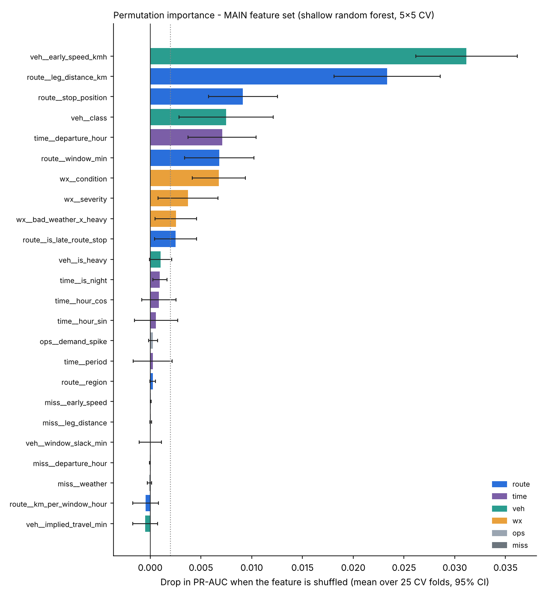
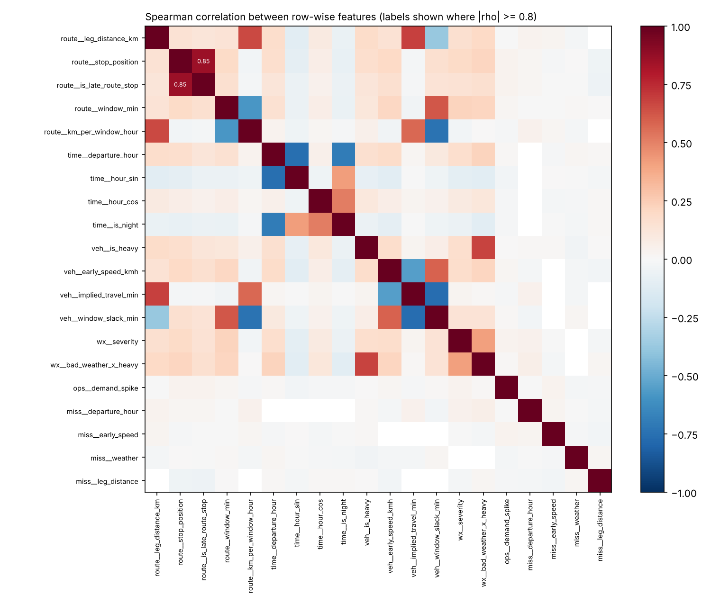
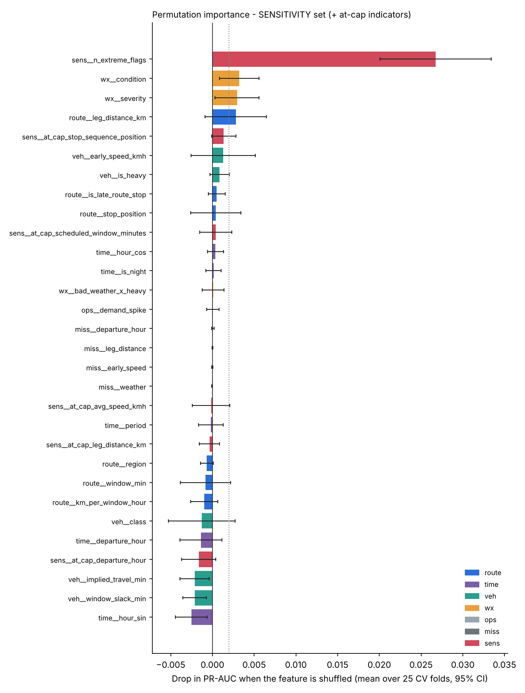
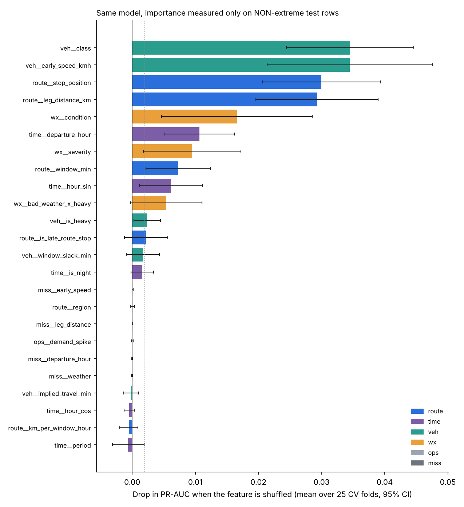

# Feature Importance & Redundancy Analysis

**Author:** Junyue Li
**Stage:** Week 3 · Task 3
**Reproduce:** `python scripts/feature_importance.py` (about 10 minutes)
**Inputs:** feature pipeline v1.1.0 (`scripts/features.py`), built from `data/processed/train_labeled.csv`. Training file only; the holdout is still sealed.
**Outputs:** `docs/week3/figures/permutation_importance_main.png` (ranked chart), plus `..._main_nonextreme.png`, `..._sens.png`, `spearman_correlation.png`; tables `permutation_importance_*.csv`, `redundancy_pairs.csv`, `selection_check.csv`, `reduced_feature_set.json`

---

## 1. Summary

- **Recommended reduced set: 11 of 24 features** (listed in §6). 13 features are dropped: 12 as noise and 1 as redundant. Each one is justified in §5.
- The reduced set keeps essentially all of the performance: **PR-AUC 0.806 vs 0.810**, F1 0.796 vs 0.795 (paired difference −0.003, 95% CI [−0.006, −0.000]).
- **Top features:** early-leg speed and leg distance by a wide margin, then stop position, vehicle class, departure hour, window width and weather.
- **Two findings that matter for week 4:**
  1. **Leaving the at-cap indicators out doesn't remove the cap signal.** The random forest's most common split points are `speed > 104.5`, `hour > 22.5`, `window > 479.5` and `stop > 21.5`. In other words, it rediscovers the caps from the raw values. The "main" set is therefore *not* cap-free for tree models (§4.2).
  2. **On the non-extreme legs, the ranking changes.** There, vehicle class and stop position matter as much as speed and distance, and the model reaches **F1 0.20 vs 0.12** for the best week 2 baseline on those rows. This is the first real signal outside the cap cluster (§4.3).

## 2. Setup

| Item | Choice | Why |
|---|---|---|
| Model | Random forest, 200 trees, `max_depth=4`, `min_samples_leaf=20`, balanced class weights, `random_state=42` | Shallow enough to be a near-baseline model (as the brief asks), but it can still use interactions and non-linear thresholds, unlike the one-split stump |
| Preprocessing | `make_preprocessor()` from the pipeline, **fit inside each training fold** | Same leakage rules as the audit (§4.3) |
| CV | **5 × 5 repeated stratified K-fold**, stratified on `is_late` × `region`, seed 42 | Identical to the week 2 baseline setup |
| Importance | `sklearn.inspection.permutation_importance` on **each held-out fold**, 5 shuffles per feature, scoring = **PR-AUC (late class)** | Measured on unseen data, so it reflects generalisation, not memorisation. PR-AUC matches the week 2 metric choice. |
| Unit | **Row-wise features** are shuffled *before* preprocessing | A one-hot group (e.g. all `veh__class__*` columns) and the fitted vehicle aggregates move with their source column, so each feature gets a single importance score |
| Uncertainty | Mean over the 25 folds ± 1.96·SD/√25, plus the share of folds where the importance was > 0 | A rough CI. Folds overlap across repeats, so the CIs are somewhat narrow. |
| Redundancy | Spearman ρ between row-wise features; **\|ρ\| ≥ 0.8** marks a redundant pair | Rank-based, so it also catches non-linear monotonic relations |

Model performance (5 × 5 CV): **PR-AUC 0.810 ± 0.036, F1 0.795** on the late class. For reference, the week 2 benchmark rule (capped value or hour 23) has F1 0.751.

## 3. Ranked feature importance (main feature set)

| Rank | Feature | Mean Δ PR-AUC | 95% CI | Folds > 0 |
|---|---|---|---|---|
| 1 | `veh__early_speed_kmh` | 0.0312 | [0.0262, 0.0361] | 100% |
| 2 | `route__leg_distance_km` | 0.0233 | [0.0181, 0.0286] | 96% |
| 3 | `route__stop_position` | 0.0091 | [0.0057, 0.0126] | 88% |
| 4 | `veh__class` (incl. its class aggregates) | 0.0075 | [0.0028, 0.0121] | 76% |
| 5 | `time__departure_hour` | 0.0071 | [0.0037, 0.0104] | 72% |
| 6 | `route__window_min` | 0.0068 | [0.0034, 0.0102] | 80% |
| 7 | `wx__condition` | 0.0068 | [0.0041, 0.0094] | 80% |
| 8 | `wx__severity` | 0.0037 | [0.0008, 0.0067] | 64% |
| 9 | `wx__bad_weather_x_heavy` | 0.0025 | [0.0005, 0.0046] | 56% |
| 10 | `route__is_late_route_stop` | 0.0025 | [0.0004, 0.0046] | 76% |
| 11 | `veh__is_heavy` | 0.0010 | [−0.0001, 0.0021] | 56% |
| 12 | `time__is_night` | 0.0009 | [0.0002, 0.0016] | 64% |
| 13–24 | `time__hour_cos`, `time__hour_sin`, `ops__demand_spike`, `time__period`, `route__region`, `miss__early_speed`, `miss__leg_distance`, `veh__window_slack_min`, `miss__departure_hour`, `miss__weather`, `route__km_per_window_hour`, `veh__implied_travel_min` | −0.0005 to +0.0008 | all include 0 except `miss__early_speed` | 36–80% |

Full numbers: `docs/week3/permutation_importance_main.csv`.

## 4. What the importance tells us

### 4.1 Redundancy

Only **one pair** passes |ρ| ≥ 0.8: `route__stop_position` and `route__is_late_route_stop` (ρ = 0.85), which is expected because one is a threshold of the other. Several moderate correlations (0.5–0.75) come from *derived* features and their inputs: implied travel time with distance and speed, slack with window, `bad_weather_x_heavy` with `is_heavy`. In every such case the derived feature turned out to add nothing (importance ≈ 0), so it is dropped as noise in §5.

**Caveat:** permutation importance *under-states* features that share information with another feature. When one is shuffled, the other still carries the signal. The time encodings (`departure_hour`, `hour_sin`, `hour_cos`, `period`, `is_night`) all describe the same hour, so each looks smaller than "hour" as a whole. That's one reason to keep one representative per group rather than to drop the whole group.

### 4.2 The cap signal is still there in the main set

The sensitivity run (main set **plus** the at-cap indicators) shows how much of the signal the caps carry:

- `sens__n_extreme_flags` alone has importance **0.027**, and every other feature collapses to **≤ 0.003**. Once the model is told directly which rows are at a cap, speed, distance, hour, window and stop position lose almost all their value.
- Even *without* the indicators, the forest's most frequent split thresholds are `veh__early_speed_kmh > 104.5` (63 splits), `time__departure_hour > 22.5` (64), `route__window_min > 479.5` (18) and `route__stop_position > 21.5` (26). These are exactly the caps.

**Conclusion:** speed and distance rank first in the main set *mainly because they contain the cap values*. Leaving out the `sens__*` columns isn't enough to keep a tree model from using a suspected leak. If Carlos confirms the caps are pipeline artifacts, week 4 needs a **"cap-neutralised" variant** in which capped values are set to missing (or those rows are evaluated separately). I've added this to the week 4 plan (§7).

### 4.3 Importance on the non-extreme legs

The same 25 models, with importance measured only on held-out rows that have no capped value and no hour-23 departure:

| Rank | Feature | Mean Δ PR-AUC (non-extreme rows) | 95% CI |
|---|---|---|---|
| 1 | `veh__class` | 0.0345 | [0.024, 0.045] |
| 2 | `veh__early_speed_kmh` | 0.0345 | [0.021, 0.048] |
| 3 | `route__stop_position` | 0.0300 | [0.021, 0.039] |
| 4 | `route__leg_distance_km` | 0.0293 | [0.020, 0.039] |
| 5 | `wx__condition` | 0.0166 | [0.005, 0.029] |
| 6 | `time__departure_hour` | 0.0107 | [0.005, 0.016] |

Out-of-fold performance on those rows: **PR-AUC 0.168, F1 0.20** (base rate 5.1%). The best week 2 baseline on these rows had F1 0.12, and random gets about 0.09. This is modest, but it is the first evidence of signal that doesn't come from the caps. It comes mostly from **vehicle class, stop position and weather**, so these features have to stay in the set even where their overall importance is smaller.

## 5. Dropped columns and why

Decision rules (fixed **before** looking at results; implemented in `select()` in the script):
- **(a) Noise:** the 95% CI includes 0 **and** mean importance < 0.002 PR-AUC.
- **(b) Redundant:** |ρ| ≥ 0.8 with a more important feature.

| Dropped feature | Rule | Evidence | Justification |
|---|---|---|---|
| `route__is_late_route_stop` | redundant | ρ = 0.85 with `route__stop_position`; 0.0025 vs 0.0091 | It's a threshold (stop ≥ 15) of a kept feature. A tree finds the best threshold itself (it chose 10.5 and 21.5, not 15). |
| `veh__is_heavy` | noise | 0.0010, CI [−0.0001, 0.0021] | A coarser grouping of `veh__class`, which is kept and is the #1 feature on non-extreme rows |
| `time__hour_sin` | noise | 0.0006, CI [−0.0016, 0.0027] | The hour is already in `time__departure_hour` (kept). Cyclical encoding mainly helps **linear** models. **Re-add if week 4 selects logistic regression.** |
| `time__hour_cos` | noise | 0.0008, CI [−0.0008, 0.0025] | As above |
| `time__period` | noise | 0.0002, CI [−0.0017, 0.0022] | A 4-bucket version of the hour; the tree splits the raw hour more finely |
| `ops__demand_spike` | noise | 0.0003, CI [−0.0001, 0.0007] | Agrees with week 2 (no association with lateness, p = 0.90). Its definition is also unconfirmed (audit R10). |
| `route__region` | noise | 0.0002, CI [−0.0000, 0.0005] | Agrees with week 2 (no regional difference, p = 0.39). **Still used for stratified CV and per-region (fairness) reporting**, just not as a model input. |
| `veh__window_slack_min` | noise | 0.0000, CI [−0.0011, 0.0011] | Derived from window, distance and speed (all kept). Also 19.8% missing, because it needs three inputs. |
| `veh__implied_travel_min` | noise | −0.0005, CI [−0.0017, 0.0007] | Derived from distance ÷ speed (both kept); unrealistic values in the EDA |
| `route__km_per_window_hour` | noise | −0.0005, CI [−0.0017, 0.0008] | Derived from distance ÷ window (both kept) |
| `miss__departure_hour` | noise | −0.0000, CI [−0.0001, 0.0000]; positive in only 36% of folds | Week 2 flagged this as MNAR (+7 pp late rate when missing), but in a multivariate model it adds nothing: the 160 affected rows are explained by the other features. **The pipeline still produces it**, and it's worth re-checking if the missing rate changes in live data. |
| `miss__weather` | noise | −0.0001, CI [−0.0003, 0.0001] | No signal; the missing category of `wx__condition` (kept) already covers it |
| `miss__leg_distance` | noise | 0.0000, CI [−0.0000, 0.0001] | No signal |

**Not dropped, but noted:** `miss__early_speed` has a tiny importance (0.00005), but its CI excludes 0 and it was positive in 80% of folds, so it stays under the rule. `time__is_night` (0.0009) stays because its CI [0.0002, 0.0016] excludes 0.

## 6. Recommended reduced feature set (11 features)

| Family | Kept features |
|---|---|
| Route | `route__leg_distance_km`, `route__stop_position`, `route__window_min` |
| Time | `time__departure_hour`, `time__is_night` |
| Vehicle | `veh__class` (+ its two fitted class aggregates), `veh__early_speed_kmh` |
| Weather | `wx__condition`, `wx__severity`, `wx__bad_weather_x_heavy` |
| Missing | `miss__early_speed` |

Machine-readable copy: `docs/week3/reduced_feature_set.json`.

**Check, using the same 5 × 5 CV** (`selection_check.csv`):

| Feature set | Features | PR-AUC (mean ± SD) | F1 | F1 on non-extreme rows* |
|---|---|---|---|---|
| Main, all features | 24 | 0.810 ± 0.036 | 0.795 | 0.20 |
| **Main, reduced** | **11** | **0.806 ± 0.037** | **0.796** | **0.20** |
| Sensitivity (+ at-cap indicators) | 30 | 0.801 ± 0.039 | 0.777 | — |

\*out-of-fold, one 5-fold pass.

The reduced set gives up a very small amount of PR-AUC (paired difference −0.003, 95% CI [−0.006, −0.000]) while cutting the inputs by more than half and removing every feature whose definition or availability was doubtful (`demand_spike`, the derived travel-time features). Adding the at-cap indicators does **not** help (0.801), because the forest already finds the caps in the raw values (§4.2).

## 7. Implications for week 4

1. **Start model selection from the 11-feature set.** If logistic regression is a candidate, add back `time__hour_sin` / `time__hour_cos`.
2. **Add a cap-neutralised variant** (capped values → missing, no indicators) and report every model three ways: all rows, non-extreme rows, cap-neutralised. The gap between them shows how much a model depends on the suspected artifact.
3. **Track non-extreme F1 as a headline number**, alongside overall F1. Current bar: 0.20 (random forest, this analysis) vs 0.12 (week 2 baseline).
4. Keep `route__region` out of the model but in every report, because of the Mountain sample-size issue.
